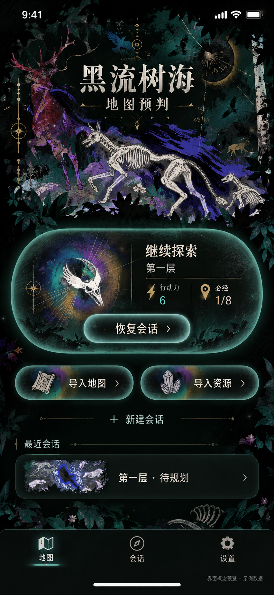
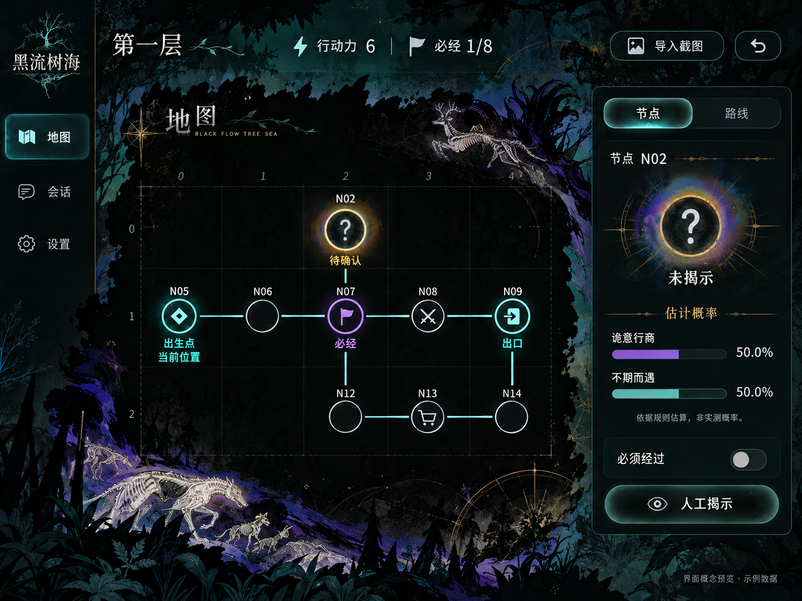
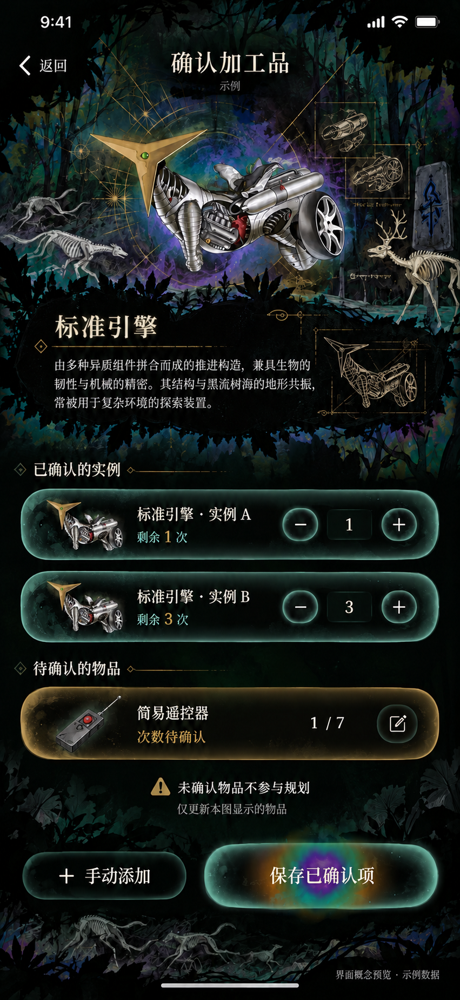
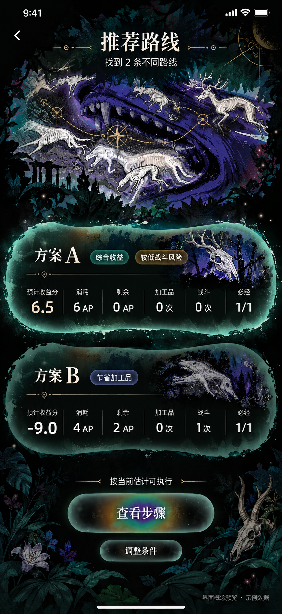

# 四图参考版预览 · V2

日期：2026-10-13。状态：规划与本轮 4 张关键页已交付；03 已另存数字修正版，04 已生成，主要文案和示例数值已目视核对。待用户视觉审阅；未实施 App。

最新实施要求覆盖历史预览：不计算节点概率；游戏对象使用 [原版图标](../../../图标/README.md)，自建动物/植物背景和首次 App 图标见 [自建素材](../../../自建素材/README.md)。以下图片和逐图检查保留原始历史记录，不能把其中的 50% 概率条、通用问号或想象出的加工品插图标为符合当前要求。

本轮用户选择先做会话首页、地图工作台、加工品确认、路线比较。使用四张新参考的墨迹拼贴、版画母题和彩色光域胶囊，部分装饰元素可按用户要求借用。原图和旧版预览保留，不写前端代码。

设计规划：[ui-design-reference-v2.md](../../ui-design-reference-v2.md)。业务来源：[ios-app-spec.md](../../ios-app-spec.md)。

| 文件 | 页面 | 状态 |
|---|---|---|
| [01-iphone-session-home.png](01-iphone-session-home.png) | iPhone 会话首页 | 已生成，主要入口与 AP/必经示例已检查 |
| [02-ipad-map-workspace.png](02-ipad-map-workspace.png) | iPad 地图工作台 | 历史稿；九条道路已检查，概率显示已过期 |
| [03-iphone-inventory-review-v2.png](03-iphone-inventory-review-v2.png) | iPhone 加工品确认 | A=1、B=3 的说明与步进器一致；待人工审阅 |
| [04-iphone-route-comparison.png](04-iphone-route-comparison.png) | iPhone 路线比较 | 已生成，评分、AP、偏好标签及次数已核对 |

## 检查与边界

全部数字为合成示例。检查地图 N14–N09 连线、AP=6、必经=1/8、A/B 路线资源及分数、两件标准引擎各 1/3 次、未确认 OCR 不加入库存。图中的文字仍需在实现时用真实文本和辅助功能接口呈现。

最终 prompt 与输入图作用记录在 [prompts.md](prompts.md)；生成后的文件尺寸和目视检查结果在此记录。静态概念图不代表 App 已实现。

## 逐图检查

实际像素尺寸：01 为 852×1846；02 为 1448×1086；03 原图为 851×1849，03 修正版和 04 均为 851×1848。保存工具实际尺寸，未拉伸或裁切。

- 01：白色骨兽、紫蓝笔触、鹿形拼贴、赭金线稿与多色光核胶囊已出现；恢复、新建、地图/资源导入与底部导航齐全；AP=6、必经=1/8。实际点击区域、动态字体和材质未运行验证。
- 02：九条示例道路均可见，包含 N14–N09；初始/当前位置、必经、出口、未揭示与问号标记可见；估计概率 50.0%/50.0%，附非实测说明；必须经过切换为关闭。
- 03：原图有实例 B 说明为 3、步进器为 1 的冲突，已保留原图作为失败证据。修正版的 A=1、B=3 及遥控器 1/7 均正确，待确认物品不参与规划说明保留。物件插图及生成的说明段落为概念占位，不替代实际游戏物件资料或功能文案。见 [问题记录](03-inventory-issue.md)。
- 04：仅两条推荐；A 标签合并综合收益/较低战斗风险，分数 6.5、消耗 6 AP、余额 0、加工品/战斗各 0、必经 1/1；B 为节省加工品，分数 −9.0、消耗 4 AP、余额 2、加工品 0、战斗 1、必经 1/1。「按当前估计可执行」说明可见，无成功率或全局最优声明。

## 页面预览

### 会话首页

### iPad 地图工作台

### 加工品确认修正版

### 路线比较

